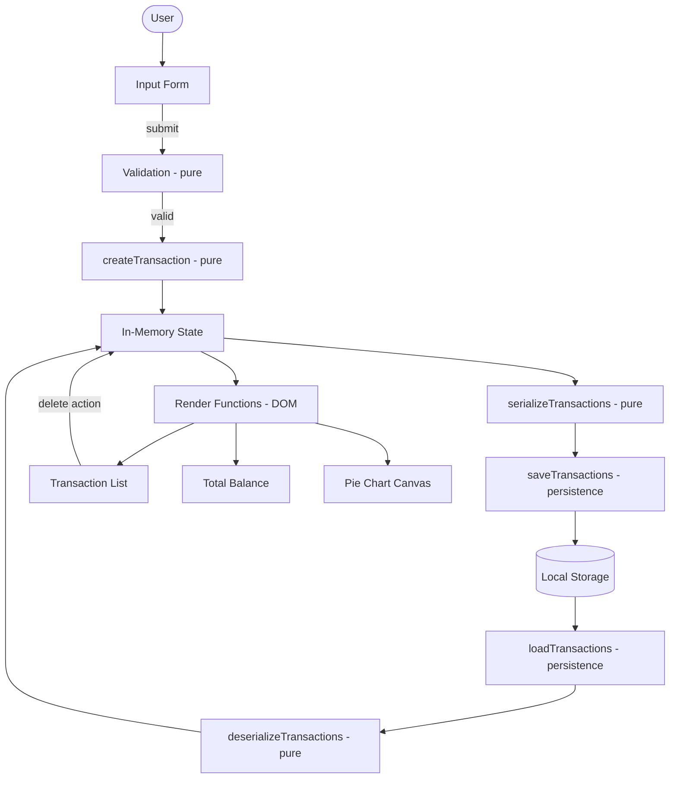
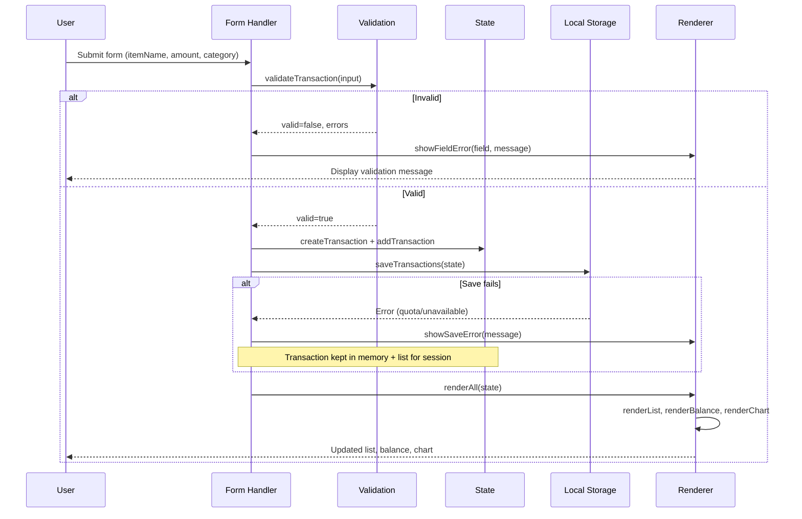

# Design Document

## Introduction

This document describes the technical design for the Expense & Budget Visualizer, a client-side web application built with HTML, CSS, and Vanilla JavaScript. It translates the approved requirements into a concrete architecture, component interfaces, data models, correctness properties, and testing strategy. The design prioritizes a zero-dependency, no-build, single-page application that runs identically as a standalone web page and as a browser extension popup.

## Overview

The Expense & Budget Visualizer lets a user record expense transactions (item name, amount, category) and immediately see the effects across three views: a scrollable transaction list, a running total balance, and a pie chart of spending by category. All data is stored client-side in the browser Local Storage API, so the application needs no backend server.

The application is intentionally minimal:

- Three core user interactions: add a transaction, delete a transaction, and observe the updated views.
- Three core views: Transaction List, Total Balance, Pie Chart.
- One input form driving all data entry.
- A single HTML file, a single CSS file, and a single JavaScript file.
- No build step, no bundler, no package manager required to run the app.

The design separates pure, side-effect-free logic (validation, computation, serialization, state transitions) from browser-dependent presentation and persistence code. The pure logic layer is the primary target for automated property-based testing.

## Architecture

### High-Level Architecture

The application uses a layered architecture with a strict separation between pure logic and side-effectful I/O. All logic that can be expressed as a function of its inputs lives in pure functions that are exported from the single JavaScript module, making them importable by the test suite. Browser-dependent code (DOM mutation, Local Storage access, Canvas drawing) is confined to presentation and persistence functions that only execute in a browser context.



### Layering

| Layer | Responsibility | Side Effects | Testable via PBT |
|-------|----------------|--------------|------------------|
| Logic (pure) | Validation, computation, serialization, state transitions | None | Yes |
| Persistence | Local Storage read/write with error handling | Local Storage I/O | Integration (mocked) |
| Presentation | DOM rendering, event handling, Canvas drawing | DOM, Canvas | Example / manual |

### Data Flow: Adding a Transaction



### File Structure

The application is organized to satisfy the single-CSS-file and single-JavaScript-file requirements. A `manifest.json` and `icons/` directory are included for the optional browser-extension deployment mode; their presence does not affect standalone usage (browsers ignore `manifest.json` when `index.html` is opened directly).

```
expense-budget-visualizer/
├── index.html              # Page structure and the single JS/CSS references
├── css/
│   └── style.css           # Exactly one stylesheet
├── js/
│   └── app.js              # Exactly one JavaScript file (pure logic + DOM bootstrap)
├── manifest.json           # Browser extension manifest (Manifest V3) - optional
└── icons/
    ├── icon16.png           # Extension toolbar icon (optional)
    ├── icon48.png
    └── icon128.png
```

### Browser Extension Deployment

For the browser-extension mode, a Manifest V3 manifest is used. It declares a popup action that opens `index.html`. No special permissions are required because the application only uses the Local Storage API (available in extension popups) and the Canvas API. The default Manifest V3 content security policy (`script-src 'self'`) is satisfied because no remote or inline scripts are used.

```json
{
  "manifest_version": 3,
  "name": "Expense & Budget Visualizer",
  "version": "1.0.0",
  "description": "Track expenses and visualize spending by category.",
  "action": {
    "default_popup": "index.html",
    "default_title": "Expense & Budget Visualizer"
  },
  "icons": {
    "16": "icons/icon16.png",
    "48": "icons/icon48.png",
    "128": "icons/icon128.png"
  }
}
```

This manifest is cross-browser compatible across Chrome, Edge, Firefox, and Safari (Safari packages the same manifest as a Safari Web Extension).

### Design Decisions and Rationale

**Decision 1: Custom Canvas pie chart instead of Chart.js.**

The original request suggested Chart.js as an option. Chart.js was evaluated and rejected for this design because:

- Requirement 6.3 mandates *exactly one* JavaScript file in `js/`. Bundling Chart.js as a second file violates this; inlining it bloats `app.js` far beyond "clean and readable."
- Manifest V3 extension popups enforce a `script-src 'self'` content security policy that blocks loading Chart.js from a CDN. A CDN-only chart therefore would not work in extension mode.
- A pie chart is simple enough to render directly with the HTML5 Canvas 2D API in roughly 50 lines, keeping the app fully self-contained and dependency-free.

This choice satisfies Requirement 6.1 (no third-party framework libraries), 6.3 (one JS file), and 6.5 (works in both standalone and extension modes) simultaneously.

**Decision 2: ES module with guarded DOM bootstrap.**

`app.js` is loaded as an ES module (`<script type="module">`). Pure functions are `export`ed so the test suite can import them. DOM initialization is wrapped in a guard (`if (typeof document !== 'undefined')`) so importing the module in Node for testing does not trigger browser-only code. This keeps the single-file constraint while making the logic layer testable.

**Decision 3: Immutable state transitions.**

State operations (`addTransaction`, `deleteTransaction`) return new arrays rather than mutating in place. This makes the functions pure and straightforward to test with property-based testing, and it avoids shared-mutable-state bugs in event handlers.

**Decision 4: Monetary amounts stored as numbers rounded to 2 decimals.**

Amounts are parsed with `parseFloat`, validated to the range 0.01–999,999,999.99, and rounded to 2 decimal places. The total balance and category aggregations are also rounded to 2 decimals to avoid floating-point drift. For exact property-based testing, the test generators use integer cents internally and convert to dollars, so sum invariants hold without floating-point error.

## Components and Interfaces

The application is divided into components by responsibility. Type signatures below use TypeScript-style notation for clarity; the implementation is plain JavaScript.

### Logic Layer (pure functions, exported for testing)

#### Validation

```ts
// Validates that the trimmed item name is 1–100 characters.
validateItemName(name: string): { valid: boolean; message: string }

// Validates that the amount is a positive numeric value in [0.01, 999999999.99].
validateAmount(amount: string | number): { valid: boolean; message: string }

// Validates that the category is one of Food, Transport, or Fun.
validateCategory(category: string): { valid: boolean; message: string }

// Validates a full transaction input, returning per-field errors.
validateTransaction(input: TransactionInput): {
  valid: boolean;
  errors: { itemName?: string; amount?: string; category?: string };
}
```

#### Computation

```ts
// Returns the sum of all transaction amounts, rounded to 2 decimals.
// Returns 0 when the array is empty.
computeTotalBalance(transactions: Transaction[]): number

// Returns the total amount spent per category, rounded to 2 decimals.
// Categories with no transactions contribute 0.
aggregateByCategory(transactions: Transaction[]): CategoryTotals
```

#### Serialization

```ts
// Serializes the transaction array to a JSON string.
serializeTransactions(transactions: Transaction[]): string

// Parses and validates a JSON string back into transactions.
// On any parse or validation failure, returns success=false with empty array.
deserializeTransactions(json: string): {
  success: boolean;
  transactions: Transaction[];
  error: string | null;
}
```

#### State Operations

```ts
// Creates a Transaction from validated input, assigning a unique id.
createTransaction(input: { itemName: string; amount: number; category: Category }): Transaction

// Returns a new array with the transaction appended (immutable).
addTransaction(state: Transaction[], transaction: Transaction): Transaction[]

// Returns a new array with the matching id removed (immutable).
deleteTransaction(state: Transaction[], id: string): Transaction[]
```

### Persistence Layer (side-effectful, integration-tested with mocks)

```ts
// Writes the serialized transactions to Local Storage under the app key.
// Returns success=false on QuotaExceededError or SecurityError.
saveTransactions(transactions: Transaction[]): { success: boolean; error: string | null }

// Reads and deserializes transactions from Local Storage.
// Returns empty transactions when the key is absent, unparseable, or invalid.
loadTransactions(): { success: boolean; transactions: Transaction[]; error: string | null }
```

The Local Storage key is the constant `EXPENSE_VISUALIZER_STORAGE_KEY = "expense_visualizer_transactions"`.

### Presentation Layer (browser-only DOM functions)

```ts
// Renders the scrollable list of transactions, or the empty-state indicator.
renderTransactionList(transactions: Transaction[]): void

// Renders the total balance at the top of the interface.
renderTotalBalance(transactions: Transaction[]): void

// Draws the pie chart on the canvas element, or an empty chart state.
renderPieChart(transactions: Transaction[]): void

// Convenience that re-renders all three views from current state.
renderAll(transactions: Transaction[]): void

// Validation and error messaging on the DOM.
showFieldError(field: string, message: string): void
clearFieldErrors(): void
showSaveError(message: string): void

// Initializes the app: loads storage, renders, attaches event listeners.
init(): void
```

### Event Handlers

```ts
// Handles form submission: validates, creates, persists, renders (or shows errors).
handleSubmit(event: SubmitEvent): void

// Handles a delete action: removes from state, persists, re-renders.
handleDelete(id: string): void
```

### HTML Structure (index.html)

The HTML defines semantic regions wired to the JavaScript via `id` attributes:

- `#balance-display` — Total Balance display at the top.
- `#transaction-form` — the input form with `#item-name`, `#amount`, `#category`, and submit button `#add-button`.
- `#validation-messages` — area for per-field validation messages.
- `#save-error` — area for persistence error messages.
- `#transaction-list` — scrollable container for transaction rows; contains an `#empty-state` element toggled when empty.
- `#pie-chart` — the `<canvas>` element for the pie chart.
- `#chart-legend` — the legend listing categories and amounts beside the chart.

## Data Models

### Transaction

A `Transaction` is the single domain entity. It is persisted to Local Storage as an element of a JSON array.

```ts
interface Transaction {
  id: string;        // unique identifier (crypto.randomUUID() with fallback)
  itemName: string;  // trimmed label, 1–100 characters
  amount: number;     // positive value in [0.01, 999999999.99], rounded to 2 decimals
  category: Category; // one of "Food" | "Transport" | "Fun"
}

type Category = "Food" | "Transport" | "Fun";
```

### Transaction Input

The raw, unvalidated data captured from the form before validation runs.

```ts
interface TransactionInput {
  itemName: string;   // raw value from the text input
  amount: string;      // raw value from the number input (string until parsed)
  category: string;   // raw value from the select
}
```

### Category Totals

The result of aggregating transactions by category for the pie chart.

```ts
interface CategoryTotals {
  Food: number;
  Transport: number;
  Fun: number;
}
```

### Result Types

```ts
interface ValidationResult { valid: boolean; message: string; }

interface DeserializeResult {
  success: boolean;
  transactions: Transaction[];
  error: string | null;
}

interface SaveResult { success: boolean; error: string | null; }
```

### Local Storage Schema

| Property | Value |
|----------|-------|
| Key | `"expense_visualizer_transactions"` |
| Value | `JSON.stringify(Transaction[])` |
| Read on | application load (`init`) |
| Written on | transaction add, transaction delete |

### ID Generation

Identifiers are generated with `crypto.randomUUID()` when available, falling back to a timestamp-plus-random string for older environments. IDs are opaque and unique within the storage scope; they are never derived from user input.

### Pie Chart Rendering Model

The pie chart is drawn from `CategoryTotals`. For each category with a non-zero total, a slice is drawn as a canvas arc whose angle is proportional to `total / grandTotal * 2π`. Fixed category colors are used:

| Category | Color |
|----------|-------|
| Food | `#4CAF50` (green) |
| Transport | `#2196F3` (blue) |
| Fun | `#FF9800` (orange) |

When the grand total is zero (no transactions), no slices are drawn and the empty-state is shown. A legend beside the chart lists each category, its total, and its color swatch.


## Correctness Properties

*A property is a characteristic or behavior that should hold true across all valid executions of a system — essentially, a formal statement about what the system should do. Properties serve as the bridge between human-readable specifications and machine-verifiable correctness guarantees.*

The following properties apply to the pure logic layer (validation, computation, serialization, state transitions). UI rendering, Local Storage I/O, and performance/deployment concerns are covered by example, integration, and smoke tests in the Testing Strategy section.

### Property 1: Total balance equals the sum of transaction amounts

*For any* list of transactions, the computed total balance SHALL equal the sum of all transaction amounts rounded to two decimal places, and SHALL be zero when the list is empty.

**Validates: Requirements 3.1, 3.4**

### Property 2: Adding a valid transaction grows the list by exactly one and includes it

*For any* current transaction list and any valid transaction, adding that transaction SHALL produce a new list whose length is exactly one greater than the original and that contains the added transaction.

**Validates: Requirements 1.3**

### Property 3: Validation accepts valid inputs and rejects invalid inputs

*For any* transaction input, the validator SHALL return valid when and only when the item name is a non-empty 1–100 character string, the amount is a positive numeric value in [0.01, 999999999.99], and the category is one of Food, Transport, or Fun; otherwise it SHALL return invalid with the affected field named.

**Validates: Requirements 1.4**

### Property 4: Deleting an added transaction restores the original state

*For any* transaction list, adding a transaction and then deleting it SHALL return a list equivalent to the original, and deleting an id that is not present SHALL leave the list unchanged.

**Validates: Requirements 2.3**

### Property 5: Category totals sum to the total balance

*For any* list of transactions, the sum of the per-category totals produced by category aggregation SHALL equal the total balance, and each category total SHALL equal the sum of the amounts of transactions in that category; when the list is empty, all category totals SHALL be zero.

**Validates: Requirements 4.1, 4.4**

### Property 6: Serialization round-trip preserves transactions

*For any* list of transactions, serializing the list and then deserializing the resulting string SHALL produce an equivalent list of transactions (matching ids, item names, amounts, and categories).

**Validates: Requirements 5.3**

### Property 7: Deserializing malformed data yields an empty result without throwing

*For any* malformed or non-JSON string, deserialization SHALL return an unsuccessful result with an empty transaction list and SHALL never throw an exception.

**Validates: Requirements 5.5**

## Error Handling

The application distinguishes three categories of error and handles each according to the requirements.

### Validation Errors (Requirement 1.4)

When the user submits the form with an empty or out-of-range field, `validateTransaction` returns `valid: false` with a per-field message. The submit handler calls `showFieldError(field, message)` for each invalid field, does not create a transaction, does not modify state, and does not touch Local Storage. Field errors are cleared (`clearFieldErrors`) before each validation pass so stale messages do not accumulate.

### Persistence Errors (Requirement 5.4)

`saveTransactions` wraps `localStorage.setItem` in a `try/catch`. On `QuotaExceededError` (storage full) or `SecurityError` (storage disabled, e.g., private browsing), it returns `{ success: false, error }`. The add handler proceeds regardless: the transaction is added to the in-memory state and rendered in the list, then if save failed, `showSaveError(message)` displays a message indicating the transaction could not be saved. The transaction is retained for the current session, satisfying the "retain in the Transaction_List for the current session" requirement. Subsequent saves retry the full current state, so once space frees up the state self-heals.

### Corrupt or Unparseable Stored Data (Requirement 5.5)

`loadTransactions` wraps `localStorage.getItem` and `JSON.parse` in `try/catch`. If the stored value is absent, `null` is returned (empty state). If parsing or validation of parsed entries fails, the unparseable data is discarded and `loadTransactions` returns an empty transaction list. The app then renders the empty Transaction List, a zero Total Balance, and an empty Pie Chart. Corrupt data never crashes the app on load.

### Empty State (Requirements 2.4, 3.4, 4.4, 5.6)

When the in-memory state is empty (no transactions, whether from an empty storage key, discarded corrupt data, or all transactions deleted), the UI shows the empty-state indicator in the list, a zero balance, and a pie chart with no slices. The empty-state indicator is toggled by `renderTransactionList` based on `transactions.length === 0`.

### Floating-Point Precision

Monetary amounts are rounded to two decimal places on parse and again on each computation (total and category aggregation) using `Math.round(value * 100) / 100`. This bounds drift from repeated floating-point addition.

### ID Generation Fallback

`createTransaction` uses `crypto.randomUUID()` when available; in environments without it, it falls back to a timestamp-plus-random string. IDs are never derived from user input, preventing collisions and injection issues.

### Cross-Browser Console Cleanliness (Requirement 6.4)

All DOM access is guarded so that missing elements do not throw at runtime. The Canvas drawing code checks for a valid 2D context before drawing. No code logs to the console during normal operation, keeping the console error-free across Chrome, Firefox, Edge, and Safari.

## Testing Strategy

### Dual Testing Approach

The feature uses a dual approach: example-based unit/integration tests for specific scenarios, edge cases, DOM rendering, and I/O wiring; and property-based tests for universal invariants of the pure logic layer. Together they provide comprehensive coverage — unit tests catch concrete bugs and integration points, property tests verify general correctness across large input spaces.

### Test Stack

- **Test runner:** Vitest (fast, native ES module support, no transpile step needed for plain JS).
- **Property-based testing:** `fast-check`, the standard PBT library for JavaScript, integrated with Vitest.
- **DOM environment:** `jsdom` (via Vitest's environment option) for rendering and interaction tests.
- **Local Storage mocking:** a small `localStorage` mock injected for persistence integration tests.
- The test stack is a dev-only dependency; the shipped application remains a zero-dependency, no-build HTML/CSS/JS bundle.

### Property-Based Tests (PBT)

PBT applies to the pure logic layer only. The following properties from the Correctness Properties section are each implemented as a single property-based test:

| Test | Property | Requirement |
|------|----------|-------------|
| Total balance equals sum | Property 1 | 3.1, 3.4 |
| Add grows list by one | Property 2 | 1.3 |
| Validation accepts/rejects correctly | Property 3 | 1.4 |
| Delete restores original state | Property 4 | 2.3 |
| Category totals sum to total | Property 5 | 4.1, 4.4 |
| Serialization round-trip | Property 6 | 5.3 |
| Malformed data deserialization | Property 7 | 5.5 |

**PBT configuration requirements:**

- Each property test runs a minimum of **100 iterations** (configured via fast-check `numRuns`).
- Amounts are generated as **integer cents** (1 to 99,999,999,999) and converted to dollars for the function under test, so sum invariants hold exactly without floating-point error; results are compared in cents.
- Each property test is tagged with a comment referencing its design property, using the format:
  `// Feature: expense-budget-visualizer, Property N: <property_text>`
- Generators cover edge cases: empty lists, single transactions, single-category lists, boundary amounts (0.01 and 999,999,999.99), whitespace-only item names, and maximal-length item names.

### Unit and Example Tests

Unit tests cover specific examples and edge cases not suited to universal properties:

- Form renders with the three required fields and the three category options (1.1, 1.2).
- A rendered transaction row contains the item name, amount, and category (2.2).
- The empty-state indicator shows when the list is empty and hides when non-empty (2.4).
- Save failure surfaces an error message while the transaction stays in the in-memory list (5.4).
- Empty storage on load renders an empty list, zero balance, and no chart slices (5.6).

### Integration Tests

Integration tests verify wiring and I/O with mocked dependencies:

- An add event triggers re-render of the list, balance, and chart (3.2, 4.2).
- A delete event triggers re-render of the list, balance, and chart (3.3, 4.3).
- `saveTransactions` is called with the new state after add (5.1) and after delete (5.2).
- `loadTransactions` reads from Local Storage and hydrates state on init (5.3).
- All rendering is exercised through `jsdom` so DOM mutations are asserted without a real browser.

### Smoke Tests

Smoke tests verify structural and deployment constraints as one-time checks:

- Exactly one CSS file exists under `css/` (6.2).
- Exactly one JavaScript file exists under `js/` (6.3).
- No third-party frontend framework references appear in the source (6.1).
- Base font size is at least 14 pixels and interactive elements are visually distinct (7.1).
- `manifest.json` is valid for Manifest V3 and the extension popup loads (6.5).

### Manual / Cross-Browser Tests

Some criteria are verified manually because they concern rendering quality, cross-browser behavior, or performance bounds:

- No console errors during load and interactions in Chrome, Firefox, Edge, and Safari (6.4).
- Initial interface renders within 1 second in each browser (7.2).
- Add/delete updates the list, balance, and chart within 200 milliseconds (7.3).
- The app loads correctly as a standalone page opened directly and as an installed extension (6.5).
